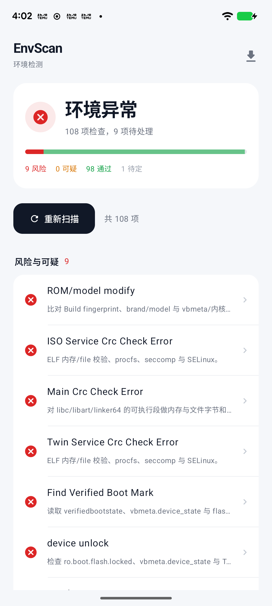
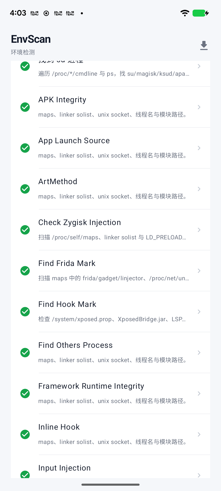

# EnvScan

Android 设备环境检测 App：一次性跑完 108 项检查，按风险优先级列出结果，点开每一项能看到
检测手法、命中原因和原始证据。

| 总览 | 详情 |
| --- | --- |
|  |  |



## 能查什么

| 分组 | 覆盖内容 |
| --- | --- |
| Root | su / Magisk / KernelSU / APatch 痕迹、模块目录、Magic Mount、mount 与分区、hide uid |
| Injection | Zygisk、Xposed/LSPosed、Riru、Frida、inline hook、ART 方法替换、注入服务、RVX |
| Hide | TracerPid、maps/map_files 隐藏、主进程与 `:iso` 的差异、Zygisk 排除列表、Shamiko |
| Integrity | libc/linker/libart 可执行段与文件比对、`/proc` 匿名可执行页、SELinux、init.rc、APEX、seccomp |
| Identity | fingerprint / vbmeta / verified boot / 解锁状态 / test-keys / 属性序列号 / Key Attestation |
| Debug | adb、开发者选项、通知监听、可调试标记、tombstone |
| Network / TEE / Emulator | VPN、网络信任链、Play Integrity 本地判定、qemu 痕迹 |

状态分四种：

- **FAIL** 命中风险
- **WARN** 可疑但不改变总评
- **PASS** 未命中
- **NA** 本机拿不到判定所需数据（不会伪造成 PASS）

只有出现 FAIL 时总评才显示“环境异常”。

## 结构

```
app/src/main/
├── cpp/
│   ├── envscan.cpp          JNI 适配层
│   └── probes/              检测技术库（纯 C++，无 Android 依赖）
├── java/fk/envscan/
│   ├── MainActivity.kt      Compose UI（总评卡 / 风险列表 / 详情弹窗）
│   ├── ScanEngine.kt        扫描编排、报告落盘
│   ├── ExtraChecks.kt       产品语义层检查（crypto/ART/init.rc/zygote/tombstone…）
│   ├── CheckGuide.kt        每项的检测手法与原因文案
│   └── IsolateService.kt    `:iso` / `:twin` / app zygote 三个辅助进程
└── aidl/                    `:iso` 服务的 Binder 接口
```

几个关键点：

- 检测技术集中在 `cpp/probes/`，`all_techniques()` 返回全部技术项，App 只负责编排和展示；
- `:iso` 是 `isolatedProcess`，`selinux_iso` 用它拿 `isolated_app` 域做对比；
- `ZygoteProbeService` 用 `useAppZygote`，让系统拉起本应用的 app zygote，主进程通过
  它的子进程看 zygote 的地址空间，判断 zygote 是否被注入；
- `:iso` / `:twin` 各自跑一遍可执行段校验，主进程把三份结果放一起比对（`crc_locality`）。

## 构建

需要 JDK 17、Android SDK（compileSdk 35）、NDK 27。

```bash
./gradlew :app:assembleDebug     # 调试包
./gradlew :app:assembleRelease   # 发布包（已配置签名）
```

产物：

- `app/build/outputs/apk/debug/app-debug.apk`
- `app/build/outputs/apk/release/app-release.apk`

仓库里同时放了构建好的发布包：`dist/envscan-1.0.0.apk`（`fk.envscan`，versionName 1.0.0，
仅 arm64-v8a）。发布签名用的是仓库内的 `keystore/envscan-release.jks`
（alias `envscan`，口令 `envscan123`），这样任何人都能复现同一个签名。

```bash
adb install -r dist/envscan-1.0.0.apk
```

## 报告

每次扫描会写一份 JSON 到
`/sdcard/Android/data/fk.envscan/files/envscan-report.json`：

```json
{
  "package": "fk.envscan",
  "verdict": "环境异常",
  "fail": 5, "warn": 0, "pass": 103,
  "items": [
    {"id": "elf_crc", "group": "Integrity", "title": "Main Crc Check Error",
     "status": "FAIL", "detail": "checked=3 issues=1 ...", "source": "native"}
  ]
}
```

## 说明

检测结果只反映扫描时刻本进程能看到的东西。不同 ROM、不同 Android 版本对 `/proc`、SELinux、
APEX 的可见性差别很大，拿不到数据的项会标 NA 而不是硬判。
