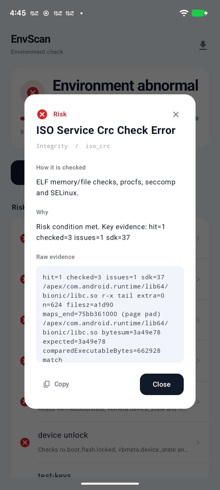

# EnvScan

Android environment inspection app. It runs 108 checks in one pass, lists the results
risk-first, and every item opens into how it is checked, why it matched and the raw evidence.

| Overview | Detail |
| --- | --- |
|  |  |


## What it checks

| Group | Coverage |
| --- | --- |
| Root | su / Magisk / KernelSU / APatch traces, module directories, Magic Mount, mounts and partitions, hidden uid |
| Injection | Zygisk, Xposed/LSPosed, Riru, Frida, inline hooks, ART method replacement, injection services, RVX |
| Hiding | TracerPid, maps/map_files hiding, main-vs-`:iso` differences, Zygisk exclusion list, Shamiko |
| Integrity | libc/linker/libart executable segments vs files, anonymous executable pages, SELinux, init.rc, APEX, seccomp |
| Identity | fingerprint, vbmeta, verified boot, unlock state, test-keys, property serial, Key Attestation |
| Debug | adb, developer options, notification listeners, debuggable flags, tombstones |
| Network / TEE / Emulator | VPN, network trust anchors, local Play Integrity judgement, qemu traces |

Each item ends up in one of four states:

- **FAIL** a risk was detected
- **WARN** suspicious, but it does not change the overall verdict
- **PASS** nothing detected
- **NA** the device or the sandbox did not expose enough data to decide (never faked as PASS)

The overall verdict only turns abnormal when at least one item fails.

## Layout

```
app/src/main/
├── cpp/
│   ├── envscan.cpp          thin JNI adapter
│   └── probes/              detection library (plain C++, no Android deps)
├── java/fk/envscan/
│   ├── MainActivity.kt      Compose UI (verdict card, risk list, detail dialog)
│   ├── ScanEngine.kt        scan orchestration, report export
│   ├── ExtraChecks.kt       product-level checks (crypto/ART/init.rc/zygote/tombstone…)
│   ├── CheckGuide.kt        per-item "how / why" text, loaded from resources
│   └── IsolateService.kt    `:iso`, `:twin` and app-zygote helper processes
├── aidl/                    Binder interface for the `:iso` services
└── res/values/strings.xml   all user-facing text
```

A few notes on the design:

- detection techniques live in `cpp/probes/`; `all_techniques()` returns the full list and the
  app only orchestrates and renders it;
- `:iso` runs as `isolatedProcess`, which gives `selinux_iso` an `isolated_app` domain to compare;
- `ZygoteProbeService` uses `useAppZygote`, so the system forks this app's own app zygote and the
  main process can inspect its address space through the child to spot zygote injection;
- `:iso` and `:twin` each run the executable-segment check, and the main process compares all
  three results (`crc_locality`).

All user-facing strings live in `res/values/strings.xml`, so the UI follows the system language;
add `res/values-<lang>/strings.xml` to ship another locale.

## Build

Requires JDK 17, Android SDK (compileSdk 35) and NDK 27.

```bash
./gradlew :app:assembleDebug     # debug build
./gradlew :app:assembleRelease   # release build (signing is configured)
```

Artifacts:

- `app/build/outputs/apk/debug/app-debug.apk`
- `app/build/outputs/apk/release/app-release.apk`

A prebuilt release is checked in at `dist/envscan-1.0.0.apk` (`fk.envscan`, versionName 1.0.0,
arm64-v8a only). Release signing uses `keystore/envscan-release.jks` (alias `envscan`,
password `envscan123`) so the build is reproducible.

```bash
adb install -r dist/envscan-1.0.0.apk
```

## Report

Every scan writes a JSON report to `/sdcard/Android/data/fk.envscan/files/envscan-report.json`:

```json
{
  "package": "fk.envscan",
  "verdict": "abnormal",
  "fail": 9, "warn": 0, "pass": 98,
  "items": [
    {"id": "elf_crc", "group": "Integrity", "title": "Main Crc Check Error",
     "status": "FAIL", "detail": "checked=3 issues=1 ...", "source": "native"}
  ]
}
```

## Notes

Results only reflect what the process can see at scan time. Visibility of `/proc`, SELinux and
APEX differs a lot between ROMs and Android versions; when the data is not available the item is
marked NA instead of being guessed.
